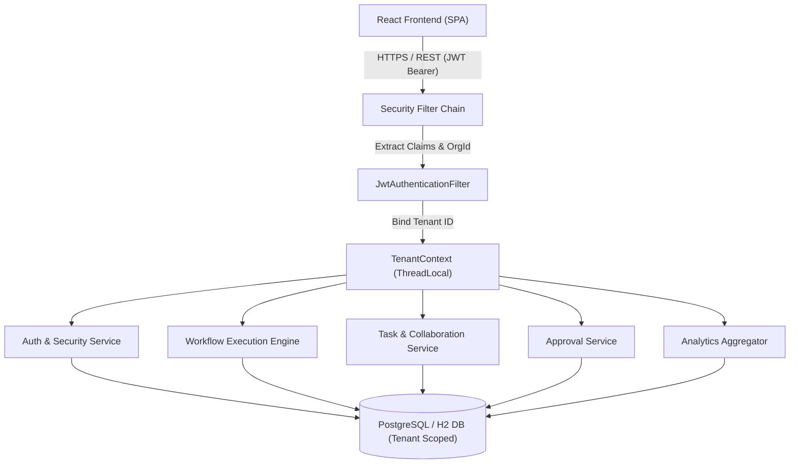
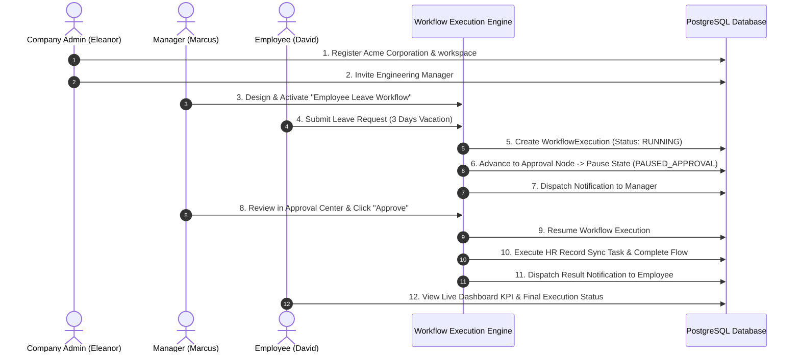
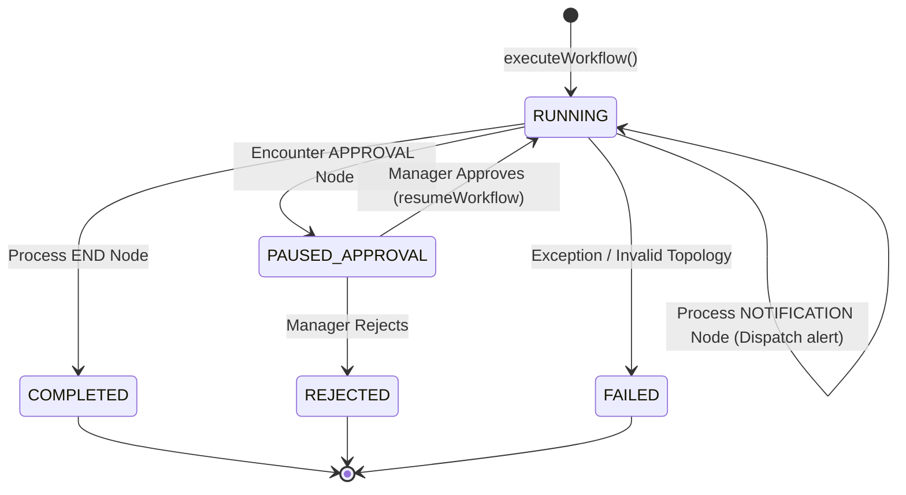

# FlowPilot AI – Commercial SaaS Architectural Specification

## 1. Multi-Tenant Architectural Overview

FlowPilot AI implements a pooled multi-tenant architecture with logical data isolation enforced at the Spring Security and Spring Data JPA query layer. Every business entity contains a foreign key to `organizations.id`.

---

## 2. Critical End-to-End Business Scenario Flow

The core scenario mandated by the enterprise master specification:

---

## 3. Workflow Engine Execution State Machine

---

## 4. Role-Based Access Control (RBAC) Matrix

| Capability | SUPER_ADMIN | COMPANY_ADMIN | MANAGER | EMPLOYEE |
| :--- | :---: | :---: | :---: | :---: |
| Platform Tenant Management | YES | NO | NO | NO |
| Workspace Branding & Settings | YES | YES | NO | NO |
| Manage Billing & Subscriptions | YES | YES | NO | NO |
| Team Member Invitations | YES | YES | YES | NO |
| Create & Publish Workflows | YES | YES | YES | NO |
| Visual Workflow Builder Access | YES | YES | YES | YES |
| Review & Decide Approvals | YES | YES | YES | NO |
| Submit Leave / Expense Requests | YES | YES | YES | YES |
| Manage Assigned Tasks & Comments | YES | YES | YES | YES |
| View Organization Analytics | YES | YES | YES | YES |
| AI Workflow Generation | YES | YES | YES | YES |
